  

---

## 🛠️ 技術堆疊

### 程式語言

### 框架與工具

---

## 📊 GitHub 統計

  
  

---

## 📂 精選清單

<!-- START_GITHUB_LISTS -->
### 📂 [Browser Extension](https://github.com/stars/tsz7250/lists/browser-extension)
- [**Netflix-Ratings**](https://github.com/tsz7250/Netflix-Ratings) ` TypeScript `  

- [**add-subtitles-extended**](https://github.com/tsz7250/add-subtitles-extended) ` JavaScript `  
  基於原始 add-subtitles 瀏覽器插件新增簡繁自動轉換功能，並修復原本的功能缺陷。

### 📂 [Side Projects](https://github.com/stars/tsz7250/lists/side-projects)
- [**yzuCourseBot**](https://github.com/tsz7250/yzuCourseBot) ` Python `  
  本專案基於原始 yzuCourseBot 進行 fork 並針對 Windows、macOS、Android 與 iOS 環境進行優化與整合。

- [**Coursio**](https://github.com/tsz7250/Coursio) ` JavaScript `  
  參考 WannaClass 的框架進行重構，並優化課表查詢功能、自動選課等功能。 

- [**n8n-launcher**](https://github.com/tsz7250/n8n-launcher) ` Shell `  
  用於 Windows 的 n8n Docker 容器管理工具，提供圖形化選單介面來管理 n8n 工作流程自動化平台，支援一鍵啟動、自動配置、版本管理、資料備份與還原等功能。

- [**Currency_chart**](https://github.com/tsz7250/Currency_chart) ` Python `  
  使用 Python Flask 框架開發多幣種匯率走勢圖，支援近 7／30／90／180 天圖表、幣別搜尋與交換，並在背景自動更新資料。

- [**ezoe-work_scraper**](https://github.com/tsz7250/ezoe-work_scraper) ` Python `  
  針對 ezoe.work 抓取文章，並輸出為格式化的 DOCX 與 PDF。

<!-- END_GITHUB_LISTS -->

---

  <h3>
    <a href="https://tsz7250.github.io">👉 查看完整作品集 👈</a>
  </h3>

